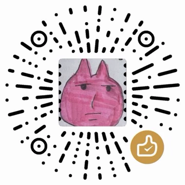

# Stage Viewer · 舞美三维查看

**中文** | [English](README.en.md)

把 3D 模型变成**一个 html 文件**：双击就能在电脑或手机浏览器里三维浏览，第一人称走进去看。发邮件、发微信都行，对方不用装任何软件。

👉 **在线使用：<https://yinqingyan.github.io/stage-viewer/>**

- **免费、开源**（MIT 许可）
- **模型不上传**：全部在你自己的浏览器里处理，网站服务器碰不到你的文件
- **生成的是离线文件**：不是在线链接，没有过期、没有账号，网速不好也能打开

## 能做什么

最早是给舞美设计师做的，但**任何 3D 模型都能用**：舞台、展台、建筑和室内、景观、产品、场景……能导出成下面这几种格式就行。

| 格式 | 说明 |
|---|---|
| **FBX**（推荐） | 3ds Max、Maya、C4D 等都能导出；勾选「嵌入媒体」，贴图会一起带上。灯具自动识别只支持 FBX |
| **GLB**（推荐） | Blender 等导出 glTF 2.0 二进制；贴图在文件里，最省事 |
| OBJ、3DS、DAE | SketchUp、Rhino 等常用；贴图可能是单独的文件，网页里会显示成白模 |

生成的网页里可以：

- 正立面、左右 45°、平面等预设视角，鼠标或手指拖动旋转、缩放
- **人物走动**：第一人称走进模型，可以坐下，看真实视线
- **导摄模式**：摆转播机位、测距离
- **观众视角**：点一个座位坐下看，显示离屏幕多远；「最左」「最右」「最后一排」一键看最差位置
- **截图、环绕视频**：当前画面存成高清图片；或从当前视角绕 90° / 180° / 360° 录成视频，不带界面
- **表面材质**：把地面、台面换成地毯、水泥、木地板、地胶、亮面，可选颜色；「保存为新文件」后发给别人也是这个样子
- 屏幕贴图开关、显示设置；右上角标出模型的长宽高

## 给舞美多做的几件事

- **灯具、桌椅自动识别**：找出模型里重复出现的灯和椅子，换成简单形状（灯口发光、可开关的光束），几百台灯的模型也能缩到几十 MB。认不出的按名字猜（Sharpy、MegaPointe、「天排光束」「频闪」……），参考资料里有 80 款灯具
- **音响识别**：名字里有型号（K2、GSL8、KS28……）的音箱自动认成线阵或超低，可以分组显示、隐藏。参考资料里有 60 款音箱
- **升降台、开合屏、转台**（测试版）：读取模型里的动画，生成滑块来控制
- **观众席方向**：按前、后、左、右视图选一下，「观众席」视角会对着舞台

不是舞台的模型，第 2 步什么都不用选，直接生成就行。

## 用法

1. 打开 <https://yinqingyan.github.io/stage-viewer/>，把模型拖进去
2. 看一眼认出的灯具、桌椅、音箱（不是舞台模型就跳过）
3. 填项目名称，点「生成并下载」，得到一个 html

导出要求和常见问题见 [模型准备说明](docs/模型准备说明.md)（也内嵌在网页里）：贴图怎么嵌入、单位怎么选、模型太大怎么缩小。

## 开发

### 不改代码，用命令行生成（只要 Python 3）

```bash
python3 skill/stage-viewer/scripts/build_html.py 模型.fbx -c 配置.json -o 输出.html
python3 skill/stage-viewer/scripts/build_html.py 模型.fbx --inspect   # 列出构件名、检查贴图是否嵌入
```

支持 .fbx、.glb、.obj、.3ds、.dae。配置字段见 `skill/stage-viewer/SKILL.md`，示例在 `skill/stage-viewer/examples/`。

### 改功能（要 Node.js）

```bash
npm install
node build.mjs        # 打包查看器模板和生成器网页（dist/舞美生成器.html）
./deploy-pages.sh     # 发布到 GitHub Pages（gh-pages 分支）
```

`build.mjs` 把 three.js 和 `src/` 打包成查看器模板；生成器（或 `build_html.py`）再把压缩后的模型和配置注入模板，得到单文件 html。

### 目录

- `src/generator.html`、`src/generator.js`：生成器网页
- `src/main.js`：查看器入口；`lights.js` 灯光，`machines.js` 机械，`props.js` 桌椅，`cameras.js`、`director.js` 机位和导摄，`i18n.js` 中英文
- `src/fbx.js`：读 FBX、识别重复的灯具桌椅、生成配置、精简模型（与 `fbx_strip.py` 结果逐字节相同）
- `src/guess.js`：按名字猜用途和型号
- `src/vendor/FBXLoader.js`：three.js 的 FBX 读取器，打了补丁（3ds Max / V-Ray 材质、旋转动画、单位）
- `docs/`：设计师说明、灯具资料（`fixtures-reference.json`）、音响资料（`speakers-reference.json`）、说明视频
- `skill/stage-viewer/`：Python 生成脚本和给 AI 用的说明
- `dev/`：做测试模型、录说明视频等小工具

## 许可和联系

MIT 许可，见 [LICENSE](LICENSE)。内含 [three.js](https://github.com/mrdoob/three.js)（MIT），`src/vendor/FBXLoader.js` 改自 three.js 自带的读取器。机位功能参考了 OpenShotDesigner（GPL）的思路，没有使用它的代码；以后修改也不要复制它的代码。

有需求和建议：认识撒库拉的直接微信，不认识的发邮件 **stageviewer.app@outlook.com**

## 支持一下

工具一直免费。觉得好用，可以微信扫一扫请撒库拉喝杯咖啡：



在海外、没有微信：[ko-fi.com/yinqingyan](https://ko-fi.com/yinqingyan)
